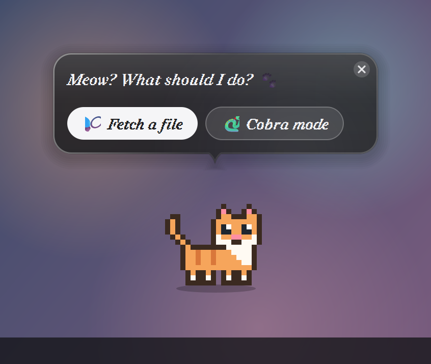
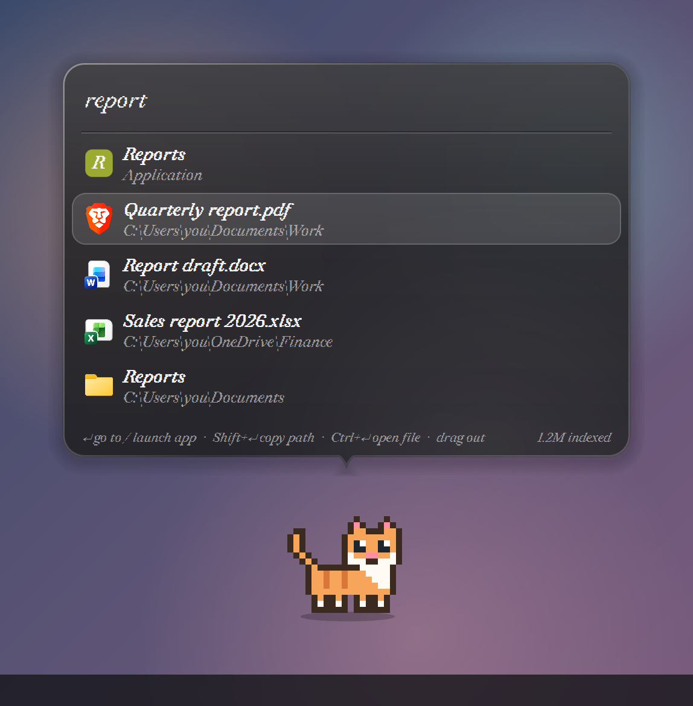
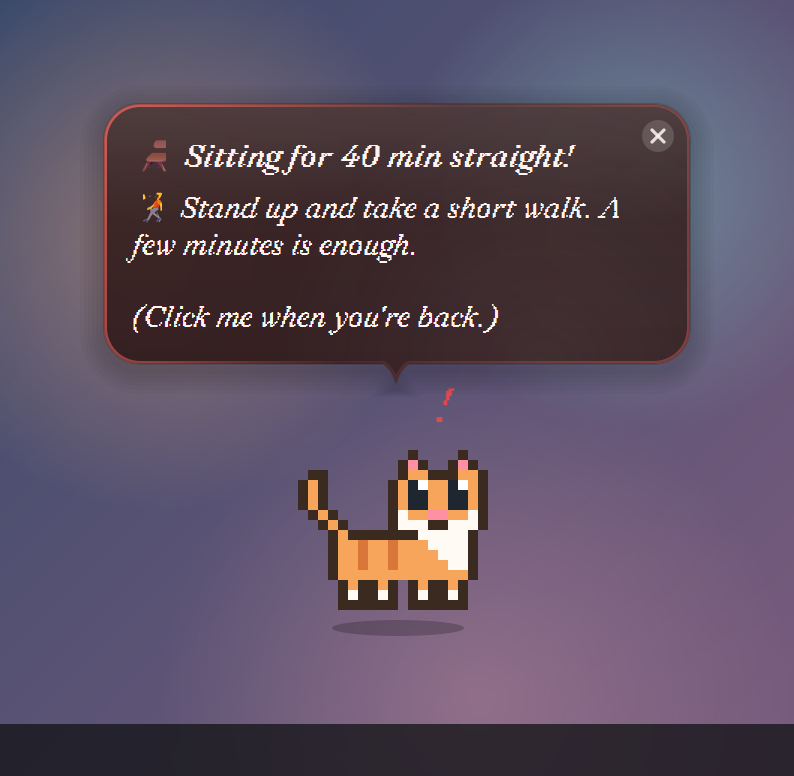
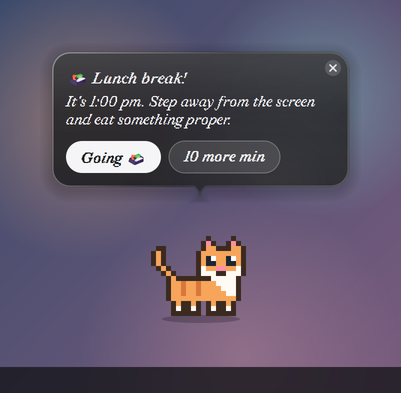
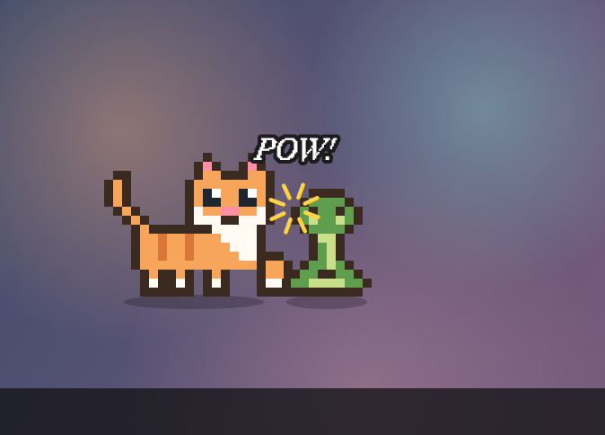
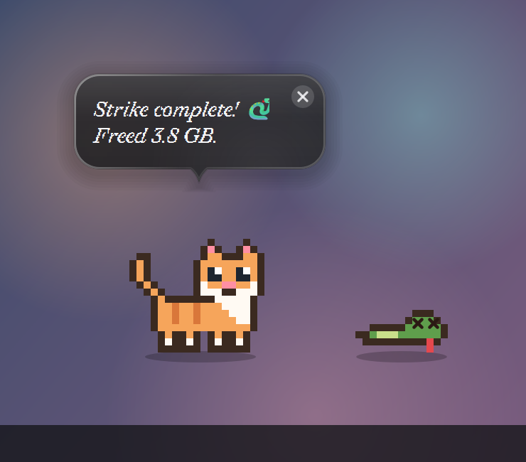

# 🐱 Desktop Cat

A tiny pixel cat that lives on top of your Windows taskbar. It **gets you off the chair**,
**reminds you to drink water, eat lunch and go home**, **fetches any file or app in
milliseconds**, and **fights a cobra** while it cleans your Recycle Bin and temp files.

Single Python file · PyQt6 · no build step · everything stays on your PC.

<p align="center">
  
  
</p>

## Features

### 🩺 Health nudges
| Reminder | When |
|---|---|
| 🚶 **Get up and walk** | after **40 min** of sitting at the screen without a break (a 5-min break resets it) |
| 💧 **Sip of water** | every **30 min** of screen time |
| 🍱 **Lunch break** | **1:00 pm**, once a day |
| 🏠 **Let's go home** | **5:45 pm**, once a day |

Idle detection uses real mouse and keyboard activity, so time away from the desk is a
break. Reminders never stack, and lunch and home have a "10 more min" button.

<p align="center">
  
  
</p>

### 🔎 Fetch a file (or app)
Double-click the cat → **Fetch a file**, and start typing. The search works like
[Everything](https://www.voidtools.com/): it keeps an in-memory index of every file name
on your fixed drives (about 2M files in ~20 s, searches in 20–80 ms), saved between runs
and kept up to date live as files change.

- **Apps:** installed apps (Start menu, including Microsoft Store apps) appear on top.
  Click one to launch it.
- **Files:** press Enter or click, and the cat runs off-screen, comes back holding the
  file, then opens its folder with the file selected.
- **Search syntax:** `words` (all must match) · `!exclude` · `"exact phrase"` ·
  `ext:pdf;docx` · `file:` · `folder:` · `app:` · `*wild?cards` · `docs\report` (path)
- **Keys:** `Enter` go to / launch · `Shift+Enter` copy path · `Ctrl+Enter` open the file ·
  `↑ ↓` select · `Esc` close · drag a result into any app

### 🐍 Cobra mode
Double-click → **Cobra mode**. The cat first shows exactly what it would clear (Recycle
Bin size and old temp/cache files), and **nothing is deleted until you click "Strike!"**.
While it cleans, a cobra appears and the cat smashes it; when it's done, the cobra keels
over with ✖✖ eyes.

<p align="center">
  
  
</p>

Safety rules: only temp/cache items untouched for **24 h+** are removed (in-use files are
newer). Ages are re-checked right before deleting. Locked files are skipped, junctions are
never followed, and all disk work runs at background I/O priority. Right-click →
*Preview reminders → Cobra fight (practice)* plays the animation without deleting anything.

### ✨ Looks
Dark-grey **liquid-glass** bubbles that blur and refract what's behind them, a crisp pixel
cat at any display scaling, and the **Redaction 50 Italic** typeface if you have it
installed (otherwise Google Sans or Segoe UI).

## Requirements
- **Windows 10 or 11** (macOS/Linux run, but idle detection is mouse-only and the file
  search, apps and Cobra mode are Windows-only)
- **Python 3.10+**
- **PyQt6** (or PySide6)

## Install & run
```bash
git clone https://github.com/<your-username>/desktop-cat.git
cd desktop-cat
pip install -r requirements.txt
python desktop_cat.py
```

**Launch it like an app:** run this once to create *Desktop Cat* shortcuts (with a cat
icon) on the Desktop and in the Start menu. They start it with `pythonw`, so no console
window appears.
```bash
python desktop_cat.py --install-shortcut
```
Then right-click the shortcut → **Pin to taskbar**. Launching it again while it's running
just makes the cat say hello. It never opens a second cat.

**Try everything quickly:**
```bash
python desktop_cat.py --demo
```
In demo mode the sitting alert fires after 30 s and water after 45 s.

## Using it
| Action | What happens |
|---|---|
| Click the cat | Status (time sitting, next walk), or acknowledge a reminder |
| Double-click the cat | Choose **Fetch a file** or **Cobra mode** |
| Right-click the cat / tray icon | Status, Fetch, Cobra, Reset timer, **Preview reminders**, Rebuild index, Quit |
| Drag the cat | Move it anywhere |

## Configuration
Everything is in the `Config` dataclass at the top of `desktop_cat.py`. The common settings
also have command-line options:

| Setting | Default | CLI |
|---|---|---|
| `alert_after_s` (max continuous sitting) | 40 min | `--alert-minutes 40` |
| `idle_threshold_s` (counts as a break) | 5 min | `--idle-minutes 5` |
| `water_every_s` | 30 min | `--water-minutes 30` |
| `lunch_time` / `home_time` | 13:00 / 17:45 | `--lunch 13:00 --home 17:45` |
| `routine_days` | every day | e.g. `(0, 1, 2, 3, 4)` for Mon–Fri |
| `index_roots` | all fixed drives | `--index D:\Work` (repeatable) |
| `fetch_trip` | on | `False` = open instantly |
| `cobra_min_age_h` | 24 | |

## Privacy
Everything runs locally, and nothing is sent anywhere. The file-name index is stored in
`%LOCALAPPDATA%\DesktopCat\`, and you can delete it any time. The glass bubbles hide
themselves from screen capture so they can blur live, which means they won't appear in
screenshots or screen shares. The cat does.

## Project layout
```
desktop_cat.py        the whole app
desktop_cat.ico       shortcut icon (regenerated by --install-shortcut)
requirements.txt
docs/screenshots/     README images
CLAUDE.md             developer reference: code map, design decisions, testing notes
```

## License
[MIT](LICENSE)
